<!-- ========================================================= -->
<!--                          HERO                             -->
<!-- ========================================================= -->

  <a href="https://github.com/OminduD">
    
  </a>

<!-- ACTION BUTTONS -->

  &nbsp;
  &nbsp;
  &nbsp;
  &nbsp;
  

 

<!-- PIPELINE STAGE 1: COMMIT -->

  

<!-- ========================================================= -->
<!--                       01 NODE_SPEC                        -->
<!-- ========================================================= -->

  <picture>
    <source media="(prefers-color-scheme: light)" srcset="./assets/head-whoami-light.svg">
    
  </picture>

  

  
    
  &nbsp;
  &nbsp;
  

<!-- PIPELINE STAGE 2: BUILD -->

  

<!-- ========================================================= -->
<!--                     02 CLUSTER_STACK                      -->
<!-- ========================================================= -->

  <picture>
    <source media="(prefers-color-scheme: light)" srcset="./assets/head-arsenal-light.svg">
    
  </picture>

  

<!-- PIPELINE STAGE 3: TEST -->

  

<!-- ========================================================= -->
<!--                    03 CLOUD_TOPOLOGY                      -->
<!-- ========================================================= -->

  <picture>
    <source media="(prefers-color-scheme: light)" srcset="./assets/head-architecture-light.svg">
    
  </picture>

  

<!-- PIPELINE STAGE 4: DEPLOY -->

  

<!-- ========================================================= -->
<!--                     04 OBSERVABILITY                      -->
<!-- ========================================================= -->

  <picture>
    <source media="(prefers-color-scheme: light)" srcset="./assets/head-telemetry-light.svg">
    
  </picture>

  

<!-- ========================================================= -->
<!--                      05 CHAOS_DRILL                       -->
<!-- ========================================================= -->

  <picture>
    <source media="(prefers-color-scheme: light)" srcset="./assets/head-space-light.svg">
    
  </picture>

  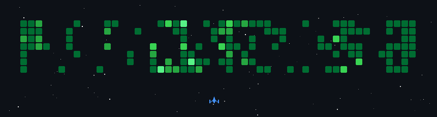

<!-- ========================================================= -->
<!--                      06 COMMIT_MESH                       -->
<!-- ========================================================= -->

  <picture>
    <source media="(prefers-color-scheme: light)" srcset="./assets/head-contrib3d-light.svg">
    
  </picture>

  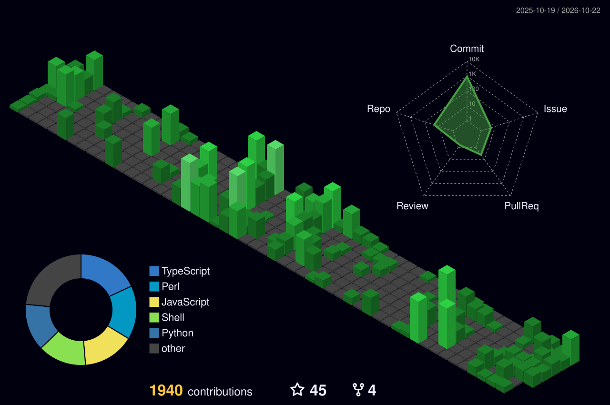

<!-- ========================================================= -->
<!--                     07 CLUSTER_MESH                       -->
<!-- ========================================================= -->

  <picture>
    <source media="(prefers-color-scheme: light)" srcset="./assets/head-pets-light.svg">
    
  </picture>

  

<!-- ========================================================= -->
<!--                 08 CERTS_AND_BADGES                       -->
<!-- ========================================================= -->

  <picture>
    <source media="(prefers-color-scheme: light)" srcset="./assets/head-certs-light.svg">
    
  </picture>

  <a href="./assets/AWSEBadge.png">
    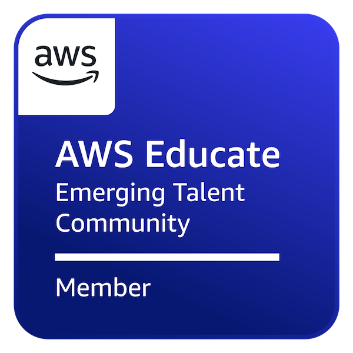
  </a>&nbsp;&nbsp;
  <a href="https://www.credly.com/badges/d3435576-6e14-466f-be23-f1a515203407/public_url">
    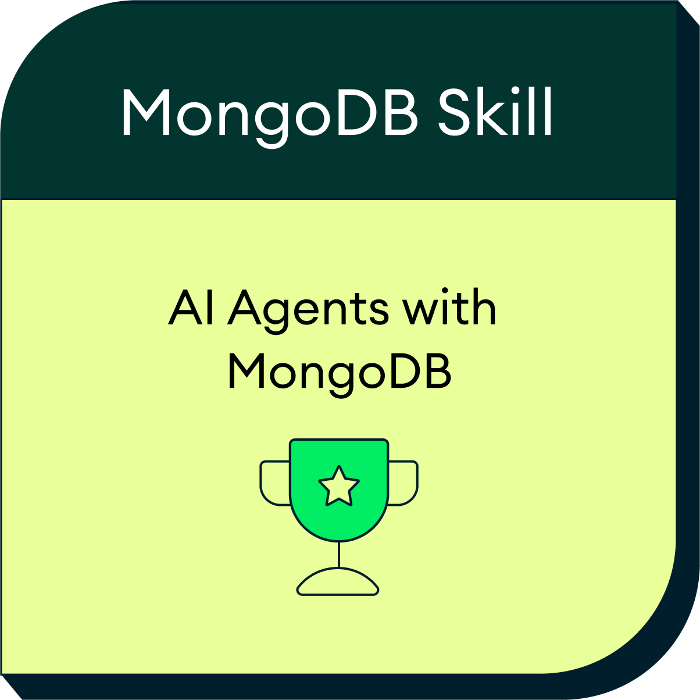
  </a>

<!-- PIPELINE STAGE 5: LIVE -->

  

<!-- ========================================================= -->
<!--                     END BANNER                            -->
<!-- ========================================================= -->

  <a href="https://github.com/OminduD">
    
  </a>

