<!-- ACTION BUTTONS -->

  &nbsp;
  &nbsp;
  &nbsp;
  

 

<!-- ========================================================= -->
<!--                       01 RUNBOOKS                         -->
<!-- ========================================================= -->

  <picture>
    <source media="(prefers-color-scheme: light)" srcset="../assets/head-intel-light.svg">
    
  </picture>

<!-- DEVOPS & CLOUD ARCHITECTURE RUNBOOKS MATRIX -->

  

 

<!-- ACADEMIC FOUNDATIONS & PROVABLE MILESTONES -->

  

 

<!-- ARCHITECTURAL RUNBOOK CARDS (100% SVG RUNBOOK SUITE) -->

  &nbsp;
   
  &nbsp;
   
  &nbsp;
  

 

<!-- ACTION BUTTONS & FOOTER -->

  &nbsp;
  &nbsp;
  &nbsp;
  

 

  

