<!-- ACTION BUTTONS -->

  &nbsp;
  &nbsp;
  &nbsp;
  

 

<!-- ========================================================= -->
<!--                       01 WORKLOADS                        -->
<!-- ========================================================= -->

  <picture>
    <source media="(prefers-color-scheme: light)" srcset="../assets/head-cases-light.svg">
    
  </picture>

<!-- MASTER WORKLOADS & CLUSTER DEPLOYMENTS MATRIX -->

  

 

<!-- CORE PRODUCTION WORKLOAD CASE STUDIES (100% SVG SUITE) -->

  &nbsp;
   
  &nbsp;
   
  &nbsp;
   
  &nbsp;
  

 

<!-- ACTION BUTTONS & FOOTER -->

  &nbsp;
  &nbsp;
  &nbsp;
  

 

  

